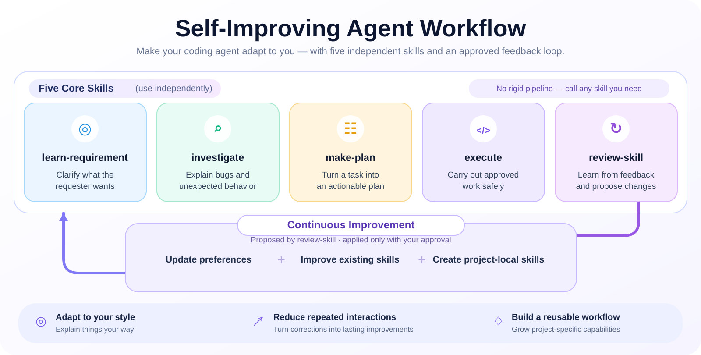
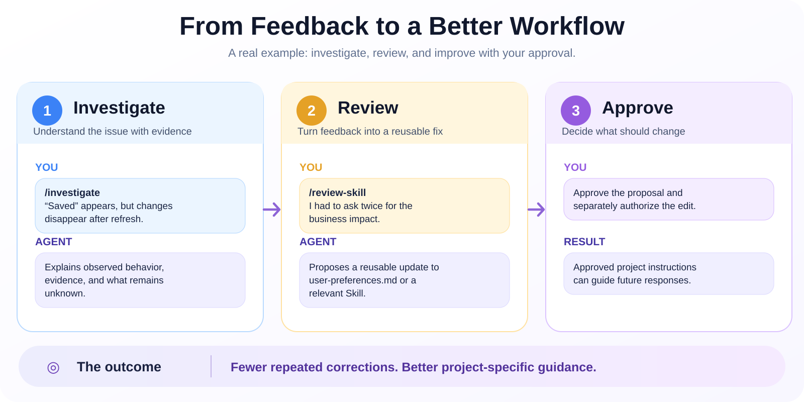

<div align="center">

# Self-Improving Agent Workflow

### Five skills. One feedback loop. An agent that adapts to you.

**Stop repeating how you want your coding agent to work.**

[](https://github.com/kou-wang/self-improving-agent-workflow/releases/latest) [](https://github.com/kou-wang/self-improving-agent-workflow/actions) [](LICENSE)

**Cursor** · **Claude Code** · **GitHub Copilot**

[Get started](#-quick-start) · [Explore the 5 skills](#-the-five-core-skills) · [How it works](#-how-it-works) · [Detailed guide](docs/overview.md)

</div>

---

## ✨ The idea

**Less prompting. Better communication. More reusable skills.** Paste a bug screenshot, trace log, or a short request; then call the relevant Skill directly. Work through the task in normal conversation. Later, `review-skill` can **propose** saving preferences—like simpler explanations or preserving English technical terms—and improving existing Skills or creating project-local ones, so you do not have to repeat those corrections.

> **Self-improving ≠ self-modifying.** Changes are evidence-based, proposed for human review, and applied only after separate authorization. No background training or automatic cross-project memory.

## 🧭 How it works

<div align="center">



</div>

<p align="center"><sub>Each Skill is independent; improvements are proposals until you approve a separate change.</sub></p>

## 🧩 The five core skills

| Skill | When to use it | Output |
| :--- | :--- | :--- |
| **[01 · Learn Requirement](skills/learn-requirement/SKILL.md)** | Understand a feature request or screenshot | Expected user-visible behavior, without implementation |
| **[02 · Investigate](skills/investigate/SKILL.md)** | Trace a bug or unexpected state | Evidence, cause when known, impact, and unknowns — **read-only** |
| **[03 · Make Plan](skills/make-plan/SKILL.md)** | Choose an implementation approach | Recommended plan, trade-offs, verification — **no edits** |
| **[04 · Execute](skills/execute/SKILL.md)** | Carry out a clear, authorized task | Actual changes and validation, within approved boundaries |
| **[05 · Review Skill](skills/review-skill/SKILL.md)** | Stop repeating a correction or preference | Proposed reusable improvement — **no automatic edits** |

## ⚡ Quick start

Install the CLI once (**Python 3.10+**, Git and [pipx](https://pipx.pypa.io/) required):

```bash
pipx install git+https://github.com/kou-wang/self-improving-agent-workflow.git
```

Run inside an **existing project directory**:

```bash
# Pick one: cursor | claude | copilot | both | all
agent-workflow install --tool cursor --language en
```

| Agent | Install option |
| :--- | :--- |
| Cursor | `--tool cursor` |
| Claude Code | `--tool claude` |
| GitHub Copilot | `--tool copilot` |
| Cursor + Claude Code | `--tool both` |
| All three | `--tool all` |

Languages: **English `en` · 简体中文 `zh-CN` · 繁體中文 `zh-TW`**. Add `--check` to preview installation. The installer preserves existing files.

## 🔁 Turn feedback into reusable improvements

<div align="center">



</div>

<p align="center"><sub>No scripted dialogue between Skills: share context and invoke only what you need. Review proposes improvements; after approval, apply with <code>/execute</code> (optionally <code>/make-plan</code> first).</sub></p>

**Key features:** independent skills · editable response defaults · project-scoped instructions · safe non-overwriting installs · managed Skill updates · backups and guarded rollback.

## 📚 Go deeper

**[Complete overview →](docs/overview.md)** — design philosophy, project layout, review loop, configuration, upgrade safety, and limitations.

[Quickstart](docs/quickstart.md) · [Cursor](docs/cursor.md) · [Claude Code](docs/claude-code.md) · [Copilot](docs/copilot.md) · [CLI / upgrades](docs/cli.md) · [Roadmap](TODO.md)

---

<sub>**Early access · v0.3.0** — Python CI is passing; real-client behavior is not exhaustively validated. Instructions do not guarantee agent compliance. Do not place secrets or private project information in public issues. [MIT License](LICENSE) · [Report an issue](https://github.com/kou-wang/self-improving-agent-workflow/issues)</sub>
